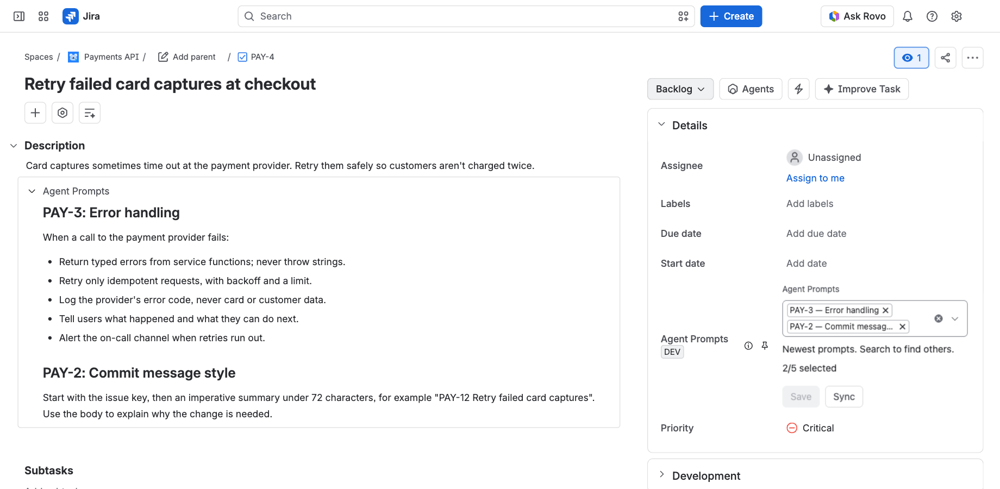
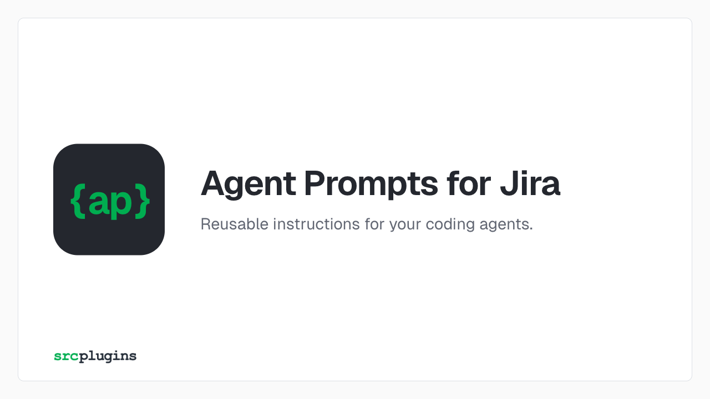

# Agent Prompts for Jira

**Reusable instructions for your coding agents.**

Stop repeating the same instructions across Jira work items. Create reusable prompts for coding standards, review guidelines and team conventions, all managed directly in Jira. Add the right prompts to each work item to give your coding agents the context they need. When your standards change, update the original prompt and sync when you're ready.

**In development** for company-managed software spaces in Jira Cloud; not yet on the Atlassian Marketplace. The [website guide](https://srcplugins.com/plugins/atlassian/agent-prompts-for-jira/) covers setup and troubleshooting in more detail.

## Features

- **Manage prompts in Jira.** Prompts are ordinary work items, with Jira's editor, permissions and history.
- **Give every work item the right context.** Add up to five prompts from the same space. Their instructions become part of the work item's description, available to coding agents that read it.
- **Stay in control.** Update a prompt once, then sync the work items that use it when you're ready. Edits to existing prompts won't appear in work items until you sync.
- **Ask Rovo.** A read-only Rovo agent finds prompts and reads them back.

## Usage

### Set up a space

A Jira administrator sets up each space once:

1. In the space, open **Space settings → Agent Prompts for Jira**, or **Configure** for the app in **Manage apps**.
2. Select spaces, choose **Configure selected**, and pick an existing work type for prompts or create a new one. Epic and subtask types aren't supported.
3. Choose **Review changes**. Shared schemes can affect spaces outside your selection; acknowledge the listed impact, then choose **Apply changes**.
4. Add the **Agent Prompts** field to the screens of work items that should use prompts.

Installing the app changes nothing until a space is set up. Prompts otherwise behave like any other work item: to keep them off boards, give the prompt type its own screen (summary and description only) and a one-status workflow, and leave that status unmapped on each board. These are ordinary Jira settings; the app doesn't change them.

### Use prompts

1. Create a work item of the prompt type. The **summary** is the prompt's name and the **description** holds its instructions (up to 4,000 characters).
2. On a work item, edit **Agent Prompts**, search by name or key, and select up to five prompts from the same space.
3. Choose **Save**. The instructions are copied into one collapsible **Agent Prompts** section of the description.
4. When a prompt changes, choose **Sync** on the work item to copy its latest version.

Remove a prompt and save to remove its copy. Standard Jira text formatting is supported, including headings, lists, code and links. Embedded content and advanced formatting are not supported. Reopen the work item to see the new description, or turn on **Reload work item after saving prompts** in the space's configuration.

If a save can't be confirmed, the app keeps your selection, doesn't repeat the write and offers **Check saved state**. Messages name the cause; the [troubleshooting guide](https://srcplugins.com/plugins/atlassian/agent-prompts-for-jira/#troubleshooting) covers recovery.

## Rovo control

Where Rovo is available on your site, the app adds the read-only **Agent Prompts Assistant** to Rovo Chat. It finds a space's prompts by name and reads their instructions back, for example "Find review prompts in TEAM" or "Read prompt TEAM-42". A search returns up to twenty matches; instructions with links or struck-out text must be read in Jira.

The agent reads as you and never changes Jira or runs a coding agent. Requests and responses are processed by Rovo under [Atlassian's Rovo data policies](https://support.atlassian.com/rovo/docs/rovo-data-privacy-and-usage-guidelines/), which may include third-party models, separately from the app's own storage.

## Permissions

| Scope | Purpose |
| --- | --- |
| `read:jira-work` | Find visible prompts and read the source and destination work items. |
| `write:jira-work` | Save the destination description and Agent Prompts field as the current user. |
| `manage:jira-configuration` | Inspect work type schemes and create or attach a prompt type after administrator review. |
| `storage:app` | Store space configuration and save-recovery records. |

Everything runs as the current user, so Jira's normal visibility rules apply. Saving needs **Edit work items**, creating prompts needs **Create work items**, and setup needs **Administer Jira**. Resolving an unconfirmed save as an administrator needs both **Administer Jira** and **Edit work items**.

## Data

- Jira stores the prompts and their copies. **Anyone who can read a work item can read the instructions copied into it**, even if the source prompt is later restricted or deleted.
- Forge app storage holds space settings, prompt IDs, content fingerprints and save-recovery records, including who ran the latest space configuration. It doesn't keep a separate copy of prompt text.
- The app sends nothing outside Atlassian (it declares no external network access) and doesn't log prompt content.
- After uninstalling, work items and copies remain. Forge keeps app data for 28 days; reinstalling doesn't restore it.

## License

[PolyForm Noncommercial License 1.0.0](LICENSE.md): source-available, not open source. Third-party components are listed in [THIRD_PARTY_NOTICES.md](THIRD_PARTY_NOTICES.md).
